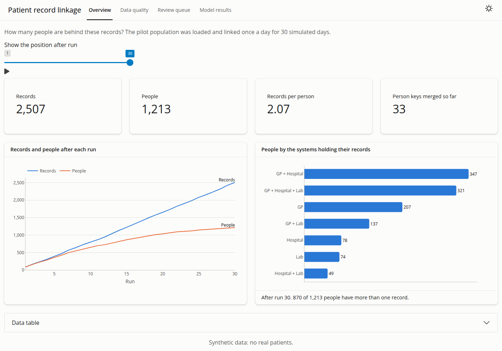
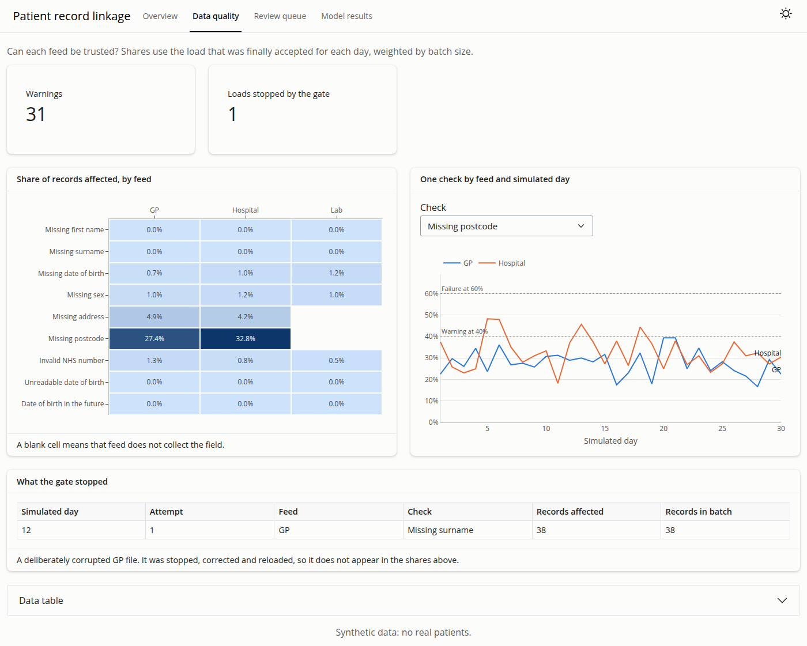

# Patient Record Linkage Pipeline

Finding the same person across messy health records, using synthetic data, data-quality checks, Splink and Airflow.


**Status:** Complete: all 9 planned steps are built, and the linkage results below are final. The daily Airflow pipeline has only been run on the 1,145-person pilot. It runs locally, on synthetic data, and is not deployed.

| At a glance | |
|---|---|
| **Problem** | Finding the same patient across hospital, GP and laboratory records without merging different people |
| **Data** | Synthetic: three independent Synthea populations of about 11,500 people, with errors injected at three levels |
| **Result** | Medium error, held-out test set: **99.90% precision and 96.34% recall**, against 99.22% and 85.81% for exact-match rules |
| **Stack** | Python, Splink 5 on DuckDB, PostgreSQL 17, Airflow 3.3, PySpark 4, Shiny, Docker |

## The problem
The same patient often appears under several records, because of typos, changed names, missing dates and different hospitals. Duplicates split a patient's history, and wrongly merging two people is worse. This project links records probabilistically, gives each person a stable ID, and measures how accurate the linkage is and for whom. The decision it supports: a data-quality lead choosing which records can be linked automatically, and how much manual review to fund.

**All data is synthetic.** No real patient data is used.

Design, decisions and evaluation rules: [docs/DESIGN.md](docs/DESIGN.md). Operating it: [docs/RUNBOOK.md](docs/RUNBOOK.md).

## How it fits together
```
 Synthea + error injector ──► source files (3 systems, daily batches)
                                      │  Airflow DAG
                                      ▼
 PostgreSQL:  raw ──► staging ──► data-quality gate ──(fail)──► stop and report
                                      │ pass
                                      ▼
 Splink on DuckDB: blocking ──► scoring ──► clustering
                                      │
                                      ▼
 PostgreSQL:  stable person keys · review queue · marts ──► Shiny dashboard

 Evaluation, kept out of the pipeline: results + truth table ──► precision, recall, by group
 Separate check: the PySpark job must reproduce the staging layer exactly
```

## Results
These come from the held-out test population, which was used once. The model was trained on one population without labels, and the 0.99 match-probability threshold was chosen on a second, as the lowest tested value reaching 99.5% precision. The baseline uses exact rules: the same NHS number, or the same first name, surname and date of birth.

| Error level | Method | Precision | Recall | F1 | People split | People falsely merged |
|---|---|---:|---:|---:|---:|---:|
| Low | Splink | 99.94% | 98.69% | 99.31% | 1.67% | 0.07% |
| Low | Baseline | 99.81% | 94.81% | 97.25% | 6.40% | 0.09% |
| Medium | Splink | 99.90% | 96.34% | 98.09% | 4.73% | 0.05% |
| Medium | Baseline | 99.22% | 85.81% | 92.03% | 17.61% | 0.57% |
| High | Splink | 99.92% | 89.15% | 94.23% | 14.52% | 0.07% |
| High | Baseline | 97.64% | 70.95% | 82.18% | 36.25% | 1.83% |

_Precision, recall and F1 are per pair of records. "People split" is the share of people with several records who were not brought together. "People falsely merged" is the share of all people placed in a cluster with someone else._

- **Splink matters most when data is poor.** At the high error level it finds 18 percentage points more true matches than the rules, with fewer false merges.
- **The errors do not fall evenly.** Women are split more often than men at every level (5.70% against 3.80% at medium). Only women have a maiden name in this data, so only they can receive the changed-surname error.
- **Some errors are hard to recover.** At the high level, records with a wrong or missing date of birth, a first name cut to an initial, or swapped names link only 57% to 64% of the time, against 98% for records with no error.

Full results: [non-technical findings](reports/findings.md) and [model card](docs/MODEL_CARD.md).

## Warehouse and data-quality gate
Source files are checked for shape, loaded unchanged into `raw`, then typed and standardised in `staging`. Each source's dates are parsed in that source's own format. Loading the same file twice adds nothing.

A quality gate then grades each source as OK, WARN or FAIL against thresholds in `configs/default.yaml`, and one FAIL stops the run. Results are saved first, so a failed run leaves evidence.

| Pilot dataset (1,145 people) | Records | Checks OK | Warnings | Failures |
|---|---:|---:|---:|---:|
| Low error | 2,445 | 28 | 0 | 0 |
| Medium error | 2,507 | 28 | 0 | 0 |
| High error | 2,639 | 27 | 1 | 0 |

The one warning is the GP feed's invalid NHS numbers (2.8%, warning at 2%). In a deliberate test, a GP file with every surname blanked stopped the run at `missing_surname`. The thresholds were set for this synthetic data and would need tuning on real feeds.

## Stable person IDs and clerical review
Splink's cluster IDs can change on every run, so each cluster inherits the existing person key it shares the most records with. A key belongs to only one cluster. When two people turn out to be one, the absorbed key redirects to the survivor, so references to it still resolve, and when a person is split, the larger part keeps the key. Each change is logged, and re-linking unchanged data changes no keys.

Pairs that scored fairly high but were not linked go to `linked.review_queue` for a person to check. A decided pair is never reopened. **Decisions are stored but do not yet change the clusters,** and there is no review screen.

## Daily orchestration with Airflow
The `patient_linkage_daily` DAG processes one day at a time: `load_and_check` loads that day's records and applies the quality gate, then `link_and_publish` re-links everything received so far and updates the person keys. Daily loads are incremental, but linkage is a full re-link (design decision D7).

**Failure handling, tested by planting a corrupted feed on day 12 of 30:**
- The gate judges each day on its own, so one bad day cannot hide behind weeks of good data.
- The failed day's data is rolled back but its check results are kept, so a corrected file can replace it.
- One failed run pauses the DAG, so no later day starts.
- After fixing the file, `make airflow-resume DAY=2026-10-12` restarts from the failed day. In the test, all 30 days then completed.

Airflow runs as one container using about 1.0 GB idle and 1.4 GB at peak on the pilot. It has its own Python environment apart from the project's, because the two need different package versions. The truth table is never mounted into the container.

## PySpark standardisation
`src/patient_linkage/spark/standardise.py` is a second implementation of the warehouse's standardisation rules, written with native Spark column functions (no Python UDFs) and run in local mode. It reads the source CSVs and writes Parquet partitioned by source. It sits outside the nightly path on purpose, because the data is small enough that PostgreSQL is the simpler tool.

`make spark` fails if a single value differs from `staging.records`. The output was identical on all seven datasets compared: `pilot/medium` and every error level of `train` and `tune`, up to 26,600 records. The held-out `test` population was left out. It takes about 22 seconds for 26,000 records and 21 seconds for 2,500, so nearly all of that time is Spark's fixed overhead.

## Dashboard
`make app` starts an interactive Shiny dashboard on <http://127.0.0.1:8050> with four pages: overview, data quality, review queue and model results.





It reads CSV files in `app/data/`, so it needs neither the database nor Airflow. `sql/marts.sql` defines the reporting views behind them, and `make marts` rebuilds the files. The views carry keys, flags and counts only, and a test fails if a name, date of birth, address or NHS number column appears in one.

## Run it
Needs Docker and [uv](https://docs.astral.sh/uv/). `make spark` also needs Java 17 or 21. To see the dashboard alone, `uv sync` and `make app` are enough.

```bash
uv sync
cp .env.example .env   # then choose a password
make db-up             # local PostgreSQL in Docker
make check             # lint + tests (database tests need db-up)
make sources POP=pilot # needs Synthea output: see data/README.md
make warehouse POP=pilot LEVEL=medium
make linkage TRAIN=pilot/medium EVAL=pilot/medium
make publish DATASET=pilot/medium
make airflow-up        # Airflow on http://127.0.0.1:8080, then unpause the DAG
make spark POP=pilot LEVEL=medium   # needs Java; compares with the warehouse
make marts             # rebuild the dashboard files
make app               # dashboard on http://127.0.0.1:8050
```

To reproduce the results, generate the populations with `scripts/generate_populations.sh`, which took 16 to 36 minutes each on a 4-core VM, then for each error level (low, medium and high; medium is shown):
```bash
make sources POP=train; make sources POP=tune; make sources POP=test   # once only
make warehouse POP=train LEVEL=medium   # likewise POP=tune and POP=test
make linkage TRAIN=train/medium EVAL=tune/medium    # choose the threshold
make linkage TRAIN=train/medium EVAL=test/medium THRESHOLD=0.99 FINAL=1
```
The last command refuses to run a second time for the same dataset, because the test population is used once.

## Limitations
- **Synthetic data only.** The injected error rates are illustrative, so these figures do not predict accuracy on real NHS data and cannot be compared with results from other datasets.
- **American names and addresses.** Synthea generates them, so UK name patterns are not represented.
- **The errors are independent by design,** which real data may not be, and the same author wrote the error injector and the model.
- **The daily pipeline has only run on the pilot.** Airflow's memory use at full population size is unmeasured.
- **Clerical review is incomplete.** Decisions are stored but do not change the clusters, and there is no review screen.
- **Linkage is a full re-link each day,** which would become slow at much larger volumes (design decision D7).
- **Airflow runs as one `standalone` container,** which is a development mode. A real deployment would run its components separately.
- **The dashboard runs locally,** and its operational pages cover the pilot only. The model results page covers the test population.
- **PySpark is a parity check, not a scale test.** It ran on up to 26,600 records in local mode, on one machine.

## Next steps
- Feed clerical review decisions back into the clusters, and add a review screen
- Run the daily Airflow pipeline at full population size
- Host the dashboard online
- Test with UK-style names and addresses

## Author
**Enock Mulenga**, Data Scientist · [LinkedIn](https://www.linkedin.com/in/enock-mulenga-8472ba137) · [Portfolio](https://mulengasnr.github.io)
